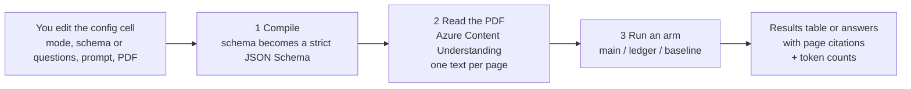
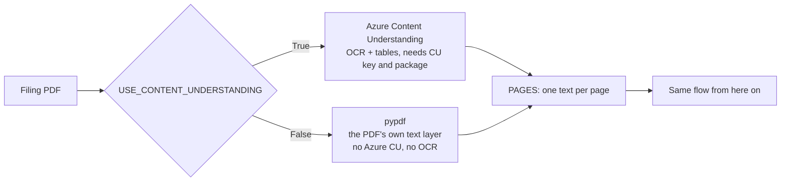
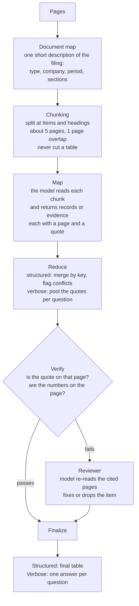
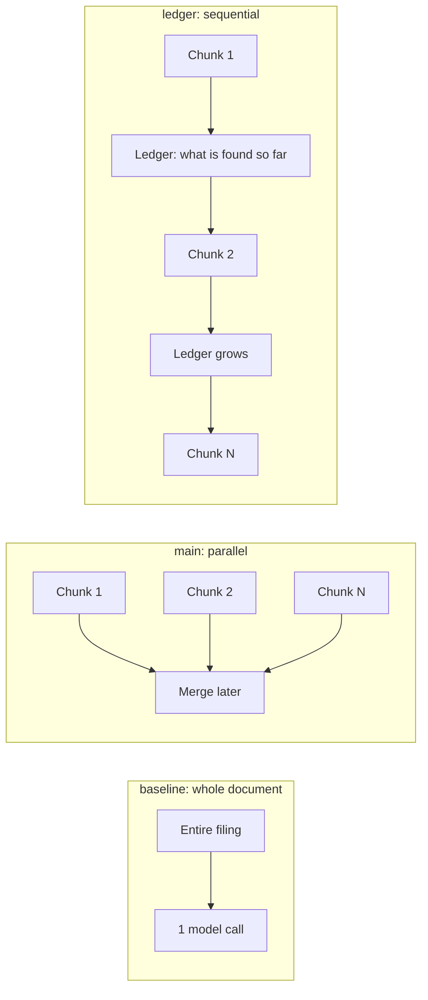

# How the SEC filing notebook works

**What it does:** you give it a long filing (10-K, S-1) and say what you want. It reads the PDF, pulls out the answer, and checks every piece against the page it came from.

**Two modes (you pick one per run):**

| Mode | You provide | You get |
|---|---|---|
| `structured` | A field list (the schema) and a task prompt | A table of records, each with a page number and a quote |
| `verbose` | One or more questions and a task prompt | A written answer per question, with page citations |

---

## 1. The big picture

---

### Two ways to read the PDF (`USE_CONTENT_UNDERSTANDING` in the config cell)

Set `USE_CONTENT_UNDERSTANDING = False` for `local`; use it only for PDFs with selectable text. A scanned PDF stops with a clear message. Tables come out as lines of text instead of markdown tables.

---

## 2. What happens inside one run

Why there is a **document map**: every chunk is read on its own, so each one gets the same short description of the whole filing. That tells it where it sits.

---

## 3. What an "arm" is

An **arm** is one strategy for the "Map" step. Everything else (compile, read, reduce, verify, review, finalize) is identical, so you can compare strategies fairly on the same input.

| Arm | How it reads | Good | Watch out |
|---|---|---|---|
| `baseline` | The whole filing in one call | Sees everything at once | Skipped when the filing is too long for one call (a 326-page S-1 is) |
| `main` | All chunks at the same time (16 at once) | Fast; start here | Chunks never see each other, only the document map |
| `ledger` | Chunks in small waves (`LEDGER_WAVE`, default 4); each wave sees what earlier waves found | Fewer repeats, can correct earlier entries | Slower than `main`; an early mistake can carry forward. `LEDGER_WAVE = 1` is strictly one by one and slowest |

You choose the arms in the run cell: `ARMS_TO_RUN = ["main"]`.

---

## 4. How the answer is kept accurate

1. Every item must carry a **page number** and a **verbatim quote**.
2. The quote is searched on that page. Small OCR differences are allowed; a **changed digit is not**.
3. For number fields, the number has to appear in the quote (sign and a thousand/million/billion scale are allowed for).
4. Items that fail go to a **reviewer** that re-reads the pages and fixes or drops the item (capped at a few steps per item).

---

## 5. Which cells to run

Edit the config cell (cell 3), then restart the kernel and **Run All**.
First-time only: the install cell. Keys come from `.env` (`AZURE_OPENAI_KEY`, `AZURE_CU_KEY`) or you are asked for them.

The run cell prints progress as it goes, then **tokens in / out / total** per arm and per stage (document map, map, review, answer), and a comparison table with one row per arm.

---

## 6. Notes about this deployment

- Model: set in the config cell (`MODEL`). All calls use chat completions through `AzureOpenAI`.
- `gpt-6-astra` refused function tools on chat completions, so every "tool call" is sent as a strict JSON-schema request (`JsonSchemaTools`). The guarantee is the same: the model can only reply with schema-valid JSON.
- Per-chunk calls use low reasoning effort for speed; the document map, answers and reviewer use medium.
